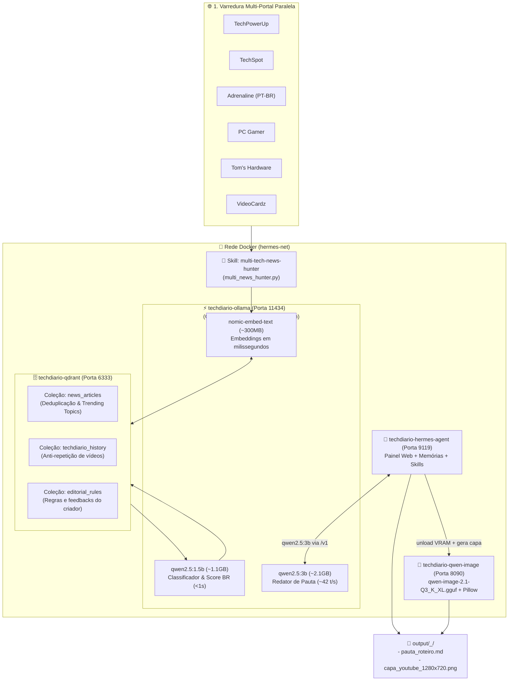

# Hermes Agent News & Thumbnail Studio v2.0 — Canal TECH DIÁRIO

Ecossistema **100% em Docker** desenvolvido para automação jornalística, geração de pautas/roteiros e criação de capas (thumbnails 1280x720) personalizadas para o canal [TECH DIÁRIO](https://www.youtube.com/@techdiario).

O sistema é calibrado para rodar localmente com alta eficiência em hardware com **NVIDIA GTX 1660 Ti (6 GB VRAM) e processador Intel Core i7-4790 (RAM DDR3)**, eliminando gargalos de offload de memória através de uma esteira modular de modelos e descarregamento dinâmico de VRAM.

---

## 1. Arquitetura do Sistema (Docker Compose)

O ambiente é orquestrado via [`docker-compose.yml`](./docker-compose.yml), dividido em 4 containers especializados conectados pela rede `hermes-net`:



### Resumo dos Serviços em Execução

| Container | Imagem / Base | Porta Host | Papel no Ecossistema |
| :--- | :--- | :--- | :--- |
| **`techdiario-hermes-agent`** | `nousresearch/hermes-agent:latest` | `http://localhost:9119` | Orquestrador autônomo baseado no Hermes Agent da NousResearch. Gerencia as Skills, o painel Web UI, as memórias persistentes e o fluxo de decisão. |
| **`techdiario-ollama`** | `ollama/ollama:latest` | `http://localhost:11434` | Servidor de inferência CUDA para modelos compactos (`nomic-embed-text`, `qwen2.5:1.5b` e `qwen2.5:3b`). Roda 100% dentro dos 6 GB de VRAM com alta taxa de tokens/segundo. |
| **`techdiario-qdrant`** | `qdrant/qdrant:latest` | `http://localhost:6333` | Banco de dados vetorial de alta velocidade. Responsável pela deduplicação semântica entre portais, agrupamento de matérias iguais e memória histórica do canal. |
| **`techdiario-qwen-image`** | `techdiario/qwen-image-engine:latest` | `http://localhost:8090` | Motor gráfico dedicado que roda `stable-diffusion.cpp` (`sd-cli`) com o modelo `qwen-image-2.1-Q3_K_XL.gguf` + pós-processamento automático em Pillow. |

---

## 2. Como Funciona o Hermes Agent neste Projeto

O **Hermes Agent** (`nousresearch/hermes-agent`) atua como o cérebro editorial do canal, seguindo a arquitetura oficial da NousResearch:

1. **Gateway e Dashboard Web (s6-overlay):**
   - O agente expõe uma interface gráfica moderna acessível pelo navegador em `http://localhost:9119` com autenticação básica protegida.
2. **Contexto e Personalidade (`config.yaml` e `SOUL.md`):**
   - Configurado especificamente para agir como Editor-Chefe, Estrategista de Conteúdo do YouTube e Diretor de Arte do TECH DIÁRIO, respondendo em Português do Brasil com foco em hardware, GPUs, IA local, mercado nacional e compras no Paraguai.
3. **Memória de Aprendizado Contínuo (`hermes_data/memories/`):**
   - `USER.md`: Guarda os dados do canal, dados de patrocínio oficial (**GATO MERCOSUL com cupom TD5**) e diretrizes do criador.
   - `MEMORY.md`: Guarda aprendizados acumulados que o agente consulta antes de sugerir pautas e capas (fórmulas de títulos de alto CTR, regras de exclusividade de layouts e regras editoriais).
4. **Catálogo Exclusivo de Skills (`hermes_data/skills/techdiario/`):**
   - O projeto utiliza a trava oficial `.no-bundled-skills` para suprimir dezenas de ferramentas genéricas de estoque do Hermes, garantindo que o modelo concentre seu raciocínio estritamente nas 3 skills do canal.

---

## 3. O Fluxo de Trabalho Passo a Passo

### Etapa 1: Coleta Multi-Portal e Agrupamento Semântico
- O script [`multi_news_hunter.py`](./hermes_data/skills/techdiario/multi-tech-news-hunter/scripts/multi_news_hunter.py) coleta notícias simultaneamente nos 6 portais de referência:
  - **TechPowerUp** (vazamentos de GPUs, BIOS e hardware aprofundado)
  - **TechSpot** (benchmarks e análises técnicas)
  - **Adrenaline** (mercado brasileiro, preços nacionais e jogos)
  - **PC Gamer** (tendências de jogos, drivers e mods)
  - **Tom's Hardware** (lançamentos de CPUs e memórias)
  - **VideoCardz** (vazamentos e datas de placas de vídeo)
- O texto de cada notícia é vetorizado em 768 dimensões pelo modelo **`nomic-embed-text`** (~300 MB VRAM) no Ollama.
- O vetor é comparado com o banco de vetores **Qdrant**:
  - **Filtro Anti-Repetição:** Se a notícia for similar (cosseno `>= 0.88`) a algum vídeo gravado nos últimos 7 dias (`techdiario_history`), ela é descartada.
  - **Cluster de Tendência:** Se 2 ou mais portais publicaram o mesmo assunto (cosseno `>= 0.84`), as matérias são unificadas em um único cluster, somando pontos de relevância.

### Etapa 2: Triagem Rápida e Classificação
- O modelo **`qwen2.5:1.5b`** (~1.1 GB VRAM) analisa os clusters em menos de 1 segundo por item e retorna um JSON estruturado:
  - Validação de relevância para o público brasileiro (`nota_relevancia_br` de 0 a 100).
  - Extração de entidades técnicas (`RTX 5070`, `GDDR7`, `AMD`, etc.).
  - Recomendação do estilo visual da capa (`alert`, `nvidia_ice` ou `versus`).
  - **Prompt Dinâmico da Capa (`prompt_arte_capa`):** Geração de prompt em inglês ultra-detalhado (8k, iluminação cinematográfica, foco fotográfico no hardware real do tema) para alimentar o motor Qwen-Image.
- As matérias aprovadas são indexadas na coleção `news_articles` do Qdrant.

### Etapa 3: Geração de Pauta e Roteiro
- O modelo **`qwen2.5:3b`** (~2.1 GB VRAM) redige o arquivo completo `pauta_roteiro.md` na pasta [`output/<data>_<slug>/`](./output/) a mais de 40 tokens/segundo:
  - **3 Opções de Títulos Magnéticos** (menos de 65 caracteres, voltados para alto CTR).
  - **Gancho Inicial (0:00 a 0:45)** focado na retenção de público.
  - **Desenvolvimento Técnico** contextualizado com o impacto no Brasil e em Ciudad del Este (Paraguai).
  - **Inserção de Patrocínio** da **GATO MERCOSUL (Cupom TD5)**.
  - **Descrição completa para o YouTube + Tags de SEO**.

### Etapa 4: VRAM Hardware Gate e Renderização da Capa
- Imediatamente antes de disparar o motor gráfico, o script [`make_thumb.py`](./hermes_data/skills/techdiario/techdiario-thumbnail-maker/scripts/make_thumb.py) ativa o **VRAM Hardware Gate (`unload_and_wait_vram`)**:
  - Envia requisição `keep_alive: 0` ao Ollama.
  - Efetua polling ativo no endpoint `http://ollama:11434/api/ps` a cada 1 segundo até confirmar que a VRAM da GPU está **100% livre** de modelos de texto.
  - Isso garante que a GTX 1660 Ti (6 GB VRAM) nunca sofra colisão ou OOM (Out of Memory).
- O container `techdiario-qwen-image` renderiza o background temático via `sd-cli` (`qwen-image-2.1-Q3_K_XL.gguf`) usando o prompt fotográfico dinâmico gerado na Etapa 2 e aplica a composição nativa 1280x720 conforme o estilo:
  - **`alert`:** Tons noturnos de sirene vermelha/âmbar + faixa policial amarela/preta + foto real `EU.jpg` em medalhão neon à esquerda + título 3D amarelo/vermelho à direita.
  - **`nvidia_ice`:** Estúdio Ártico Branco & Ciano Gelado + HUD `WHITE` + arte `EU COM LOGO.png` à direita + título 3D branco/ciano na base esquerda.
  - **`versus`:** Tela dividida diagonalmente (Vermelho/Laranja AMD vs Verde Matrix NVIDIA) + raio central `VS` + foto `EU.jpg` à direita + título 3D no topo esquerdo.

---

## 4. Estrutura de Arquivos do Projeto

```
c:\dev\hermes-agent-news\
├── .vscode/
│   └── settings.json           # Mantém a árvore do VS Code limpa, ocultando bancos e locks
├── .env                        # Variáveis de portas e modelos
├── .gitignore                  # Impede tracking de modelos pesados e bancos binários
├── docker-compose.yml          # Definição e orquestração dos 4 containers
├── README.md                   # Esta documentação unificada
├── CANAL TECH DIARIO/          # Ativos visuais oficiais do canal
│   ├── CAPA.png                # Referência visual de estilo e paleta
│   ├── EU COM LOGO.png         # Recorte do apresentador com tablet/logo
│   └── LOGO SIMPLES.png        # Logo transparente para marcas d'água
├── hermes_data/                # Volume de dados do Hermes Agent
│   ├── .no-bundled-skills      # Trava oficial contra inchaço de skills genéricas
│   ├── config.yaml             # Configuração do agente (LLM Ollama + personalidade)
│   ├── memories/               # Memória viva (USER.md e MEMORY.md)
│   └── skills/techdiario/      # Skills ativas do canal
│       ├── multi-tech-news-hunter/
│       ├── techdiario-pauta-generator/
│       └── techdiario-thumbnail-maker/
├── models/                     # Modelos do motor gráfico Qwen-Image
│   ├── mmproj-F16.gguf
│   ├── qwen-image-2.1-Q3_K_XL.gguf
│   ├── Qwen3-VL-8B-Instruct-UD-Q3_K_XL.gguf
│   └── qwen_image_2.1_vae_bf16.safetensors
├── scripts/                    # Scripts utilitários em Shell (Bash)
│   ├── download-models.sh      # Valida e baixa os modelos de difusão
│   └── run-news-cycle.sh       # Dispara um ciclo completo via terminal
├── services/qwen-image/        # Dockerfile e API FastAPI do motor gráfico
│   ├── Dockerfile
│   ├── app.py
│   └── overlay_utils.py
└── output/                     # Diretórios gerados por tema (roteiro + capa)
```

---

## 5. Como Iniciar e Usar

### 1. Inicializar os Containers
```powershell
docker compose up -d
```

### 2. Acessar os Painéis Web
- **Hermes Web Dashboard:** [`http://localhost:9119`](http://localhost:9119)
  - **Usuário:** `techdiario`
  - **Senha:** `techdiario`
- **Qdrant Vector Dashboard:** [`http://localhost:6333/dashboard`](http://localhost:6333/dashboard)
  - Visualização gráfica das coleções de vetores e das matérias deduplicadas.
- **Ollama API:** [`http://localhost:11434`](http://localhost:11434)
- **Qwen-Image Health Check:** [`http://localhost:8090/health`](http://localhost:8090/health)

### 3. Comandos Rápidos pelo Terminal

- **Extrair e produzir TODAS as notícias do dia de cada portal:**
  ```bash
  ./scripts/run-news-cycle.sh --all
  ```

- **Produzir as TOP N pautas mais relevantes do dia (ex: 5):**
  ```bash
  ./scripts/run-news-cycle.sh -t 5
  ```

- **Roteirizar todas as pautas do dia rapidamente (sem renderizar capas):**
  ```bash
  ./scripts/run-news-cycle.sh --all --skip-thumbs
  ```

- **Executar apenas a busca e classificação multi-portal das notícias de hoje:**
  ```bash
  docker exec techdiario-hermes-agent python3 /opt/data/skills/techdiario/multi-tech-news-hunter/scripts/multi_news_hunter.py --all
  ```

- **Gerar uma thumbnail avulsa personalizada:**
  ```powershell
  docker exec techdiario-hermes-agent python3 /opt/data/skills/techdiario/techdiario-thumbnail-maker/scripts/make_thumb.py `
    --prompt "Futuristic white GPU graphics card on dark neon table, 8k" `
    --headline "RTX 5060 Ti FINA!" `
    --badge "16GB GDDR7" `
    --theme-style "nvidia_ice" `
    --subfolder "minha_capa_teste"
  ```

### 4. Automação Diária Nativa (Hermes Cron)
O agente possui agendamento autônomo matinal configurado diretamente no motor interno do Hermes Agent (`hermes cron`):
- **Job ID:** `49485f76ad84` (`Ciclo-Matinal-TechDiario`)
- **Horário:** Todos os dias às **07:00 da manhã** (`0 7 * * *`)
- **Execução:** Dispara o orquestrador determinístico `cycle.py` conectando todas as etapas sem alucinação de LLM.

Para gerenciar o cron nativo pelo terminal:
```powershell
# Listar tarefas agendadas
docker exec techdiario-hermes-agent hermes cron list

# Executar imediatamente uma tarefa de teste
docker exec techdiario-hermes-agent hermes cron run 49485f76ad84
```

---

## 6. Como Personalizar o Sistema

- **Adicionar ou Alterar Palavras-Chave de Relevância:**
  Edite o dicionário `KEYWORDS_WEIGHTS` no arquivo [`hermes_data/skills/techdiario/multi-tech-news-hunter/scripts/multi_news_hunter.py`](./hermes_data/skills/techdiario/multi-tech-news-hunter/scripts/multi_news_hunter.py).
- **Alterar Dados do Canal ou Patrocinadores:**
  Edite os arquivos [`hermes_data/memories/USER.md`](./hermes_data/memories/USER.md) e [`hermes_data/memories/MEMORY.md`](./hermes_data/memories/MEMORY.md). O agente consulta esses arquivos dinamicamente antes de gerar cada pauta.
- **Criar Novos Estilos Visuais para as Capas:**
  Adicione novos presets em `THEME_PRESETS` e novos blocos visuais na função `apply_exclusive_scene_art()` do arquivo [`services/qwen-image/overlay_utils.py`](./services/qwen-image/overlay_utils.py).
- **Substituir Fotos do Criador:**
  Basta trocar os arquivos dentro da pasta [`CANAL TECH DIARIO/`](./CANAL%20TECH%20DIARIO/) mantendo os mesmos nomes de arquivo.
